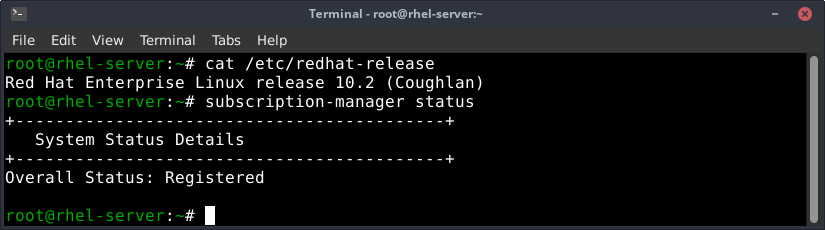
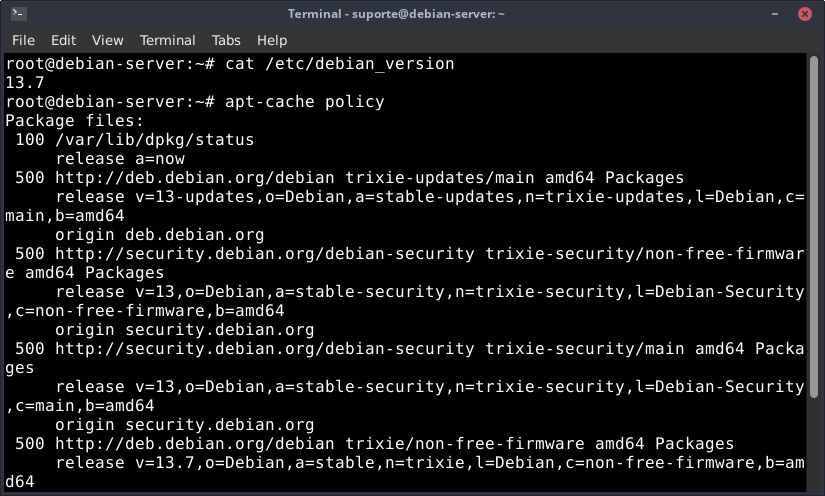

# Enterprise Linux Package Management: RHEL & Debian Practical Labs

Repositório técnico documentando a implementação prática, resolução de problemas de arquitetura, integridade criptográfica e políticas avançadas de gestão de pacotes nas duas maiores distribuições corporativas do ecossistema GNU/Linux: **Red Hat Enterprise Linux (RHEL 10)** e **Debian GNU/Linux**.

---

## 🎯 Objetivos Técnicos do Laboratório

- Demonstrar a divisão arquitetural entre motores locais de baixo nível (`rpm` / `dpkg`) e gerenciadores com resolução automática de dependências e rede (`dnf` / `apt`).
- Executar e documentar o registro corporativo no **Red Hat Subscription Management (RHSM)** com validação de status e Simple Content Access (SCA).
- Simular e diagnosticar cenários reais de falha em produção:
  - Incompatibilidade de arquitetura de CPU (`aarch64` vs `x86_64`).
  - Dependências não satisfeitas e limites de integridade com `--nodeps` e `--force`.
  - Transações interrompidas durante execução de *scriptlets* de Kernel/SELinux e sua recuperação.
- Implementar políticas avançadas de controle de versões:
  - AppStream Modules e Streams no RHEL.
  - Priorização e controle de fontes com APT Pinning (`/etc/apt/preferences.d/`) e chaves seguras em `/etc/apt/keyrings/`.

---

## 🛠️ Cenários Executados no Laboratório

### 1. Ecossistema Red Hat Enterprise Linux (RHEL)
- **Registro de Host:** Configuração via `subscription-manager` e sincronização de canais BaseOS e AppStream.
- **Auditoria de Arquitetura:** Análise de falha na tentativa de instalação de binário ARM64 (`forticlient...aarch64.rpm`) em host x86_64, demonstrando por que o `--nodeps` não contorna limites físicos de instruções de processador.
- **Rastreamento de Recursos:** Mapeamento de donos de binários com `rpm -qf` e busca reversa de bibliotecas via `dnf provides`.
- **Governança de Cache:** Higienização de pacotes locais descarregados com `yum clean packages` e inspeção de scripts de post-install.

### 2. Ecossistema Debian
- **Manipulação Atômica com `dpkg`:** Instalação e verificação de metadados (`-I`, `-c`, `-S`), com demonstração do impacto de dependências órfãs e reparo automatizado via `apt --fix-broken install`.
- **Remoção Segura:** Diferenciação operacional entre remoção padrão (`dpkg -r` / `apt remove`) e expurgo total de configurações (`dpkg -P` / `apt purge`).
- **APT Pinning e Segurança GPG:** Estruturação de regras de prioridade em `/etc/apt/preferences.d/` para balancear versões estáveis com repositórios pontuais sem promover o sistema inteiro para *testing*.

---

## 📊 Matriz Comparativa de Comandos

| Função de Engenharia | Red Hat (RHEL - DNF/RPM) | Debian (APT/dpkg) |
| :--- | :--- | :--- |
| **Instalação via Repositório** | `dnf install <pacote> -y` | `apt install <pacote> -y` |
| **Instalação Local (Baixo Nível)** | `rpm -ivh <arquivo.rpm>` | `dpkg -i <arquivo.deb>` |
| **Identificar Dono de Arquivo** | `rpm -qf /caminho/arquivo` | `dpkg -S /caminho/arquivo` |
| **Listar Conteúdo de Arquivo Local**| `rpm -qlp <arquivo.rpm>` | `dpkg -c <arquivo.deb>` |
| **Remoção com Configurações** | `rpm -evh <pacote>` | `dpkg -P <pacote>` |
| **Reparar Dependências Quebradas**| `dnf check` / `dnf complete-transaction` | `apt --fix-broken install` |

e

